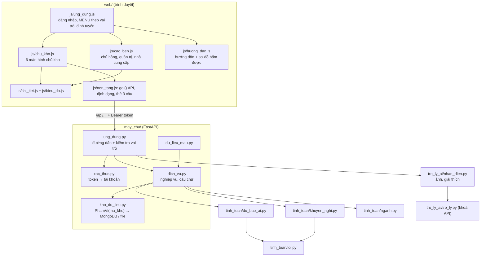
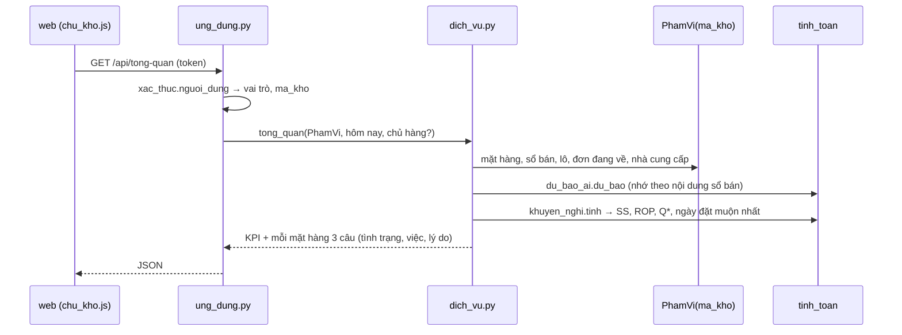
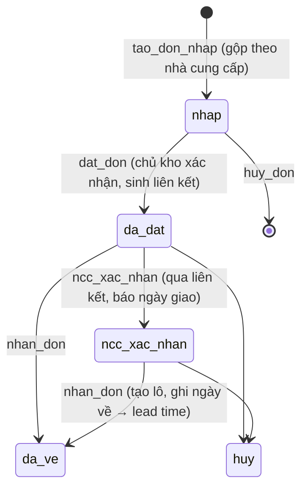

# AGENTS.md: đọc file này TRƯỚC mỗi lần chỉnh sửa hoặc chạy test

**SmartStock AI** gợi ý nhập hàng cho tiểu thương bán hàng có hạn dùng, có mùa vụ: *còn bao nhiêu, có cần đặt không, đặt
bao nhiêu, muộn nhất ngày nào*. Dự án có HAI giao diện dùng chung lõi `tinh_toan/`:

- **Bản web V1.1** (chính): FastAPI `may_chu/` + giao diện `web/`, nhiều vai trò, lưu MongoDB. Xem **mục 0**.
- **Bản phân tích cũ**: Streamlit `app.py` + `giao_dien/` (nhập gộp nhiều mặt hàng, mô phỏng, trợ lý AI). Xem mục 1–6.

| Cần biết | Đọc ở đâu |
|---|---|
| Cách làm việc, quy tắc, sửa gì ở đâu | file này |
| Thuật toán, tham số, kết quả số, lịch sử chỉnh sửa | [tai_lieu/DU_AN.md](tai_lieu/DU_AN.md) |
| Cơ sở khoa học (tài liệu tham khảo) | [tai_lieu/NGHIEN_CUU_HANG_THUC_PHAM.md](tai_lieu/NGHIEN_CUU_HANG_THUC_PHAM.md) |
| Cách chạy cho người dùng | [README.md](README.md) |

---

## 0. Bản web SmartStock AI V1.1

Đặc tả: [tai_lieu/DAC_TA_V1.1.md](tai_lieu/DAC_TA_V1.1.md). Chạy: `python -m uvicorn may_chu.ung_dung:app --port 8600`.

### 0.1 Sơ đồ tầng (tầng trên chỉ gọi tầng dưới)



### 0.2 Luồng một yêu cầu "tổng quan kho"



### 0.3 Vòng đời đơn hàng


Đơn ở `da_dat` / `ncc_xac_nhan` được tính là **hàng đang về**.

### 0.4 Muốn sửa X thì vào đâu (bản web)

| Cần sửa | File / vị trí |
|---|---|
| Thêm / đổi màn hình, thứ tự menu của một vai trò | `web/js/ung_dung.js` (`MENU`, `TRANG_DAU`) + hàm `ve_*` trong `chu_kho.js` / `cac_ben.js` |
| Thẻ "3 câu hỏi", định dạng số / ngày, thông báo, ngăn kéo | `web/js/nen_tang.js` |
| Câu chữ tình trạng / việc nên làm / lý do / rủi ro | `may_chu/dich_vu.py` (`_loi_noi`) |
| Nội dung hướng dẫn và các sơ đồ trong app | `web/js/huong_dan.js` (hằng `BUOC`, `LAN`, `TINH`, `TANG` ở đầu file) |
| Màu, cỡ chữ, bố cục | `web/kieu.css` (biến ở `:root`) |
| Công thức SS / ROP / Q* / ngày đặt muộn nhất, what-if CSL, đo CSL thực tế | `tinh_toan/khuyen_nghi.py` |
| Mô hình dự báo, so sánh WAPE, phương sai | `tinh_toan/du_bao_ai.py` |
| Thêm ngành, ngày sự kiện, tham số mặc định | `tinh_toan/nganh.py` (`GOI`) |
| Ước lượng số ngày hàng về từ đơn đã nhận | `khuyen_nghi.uoc_luong_lead_time` · `dich_vu.lead_time_ncc` |
| Kiểm tra dữ liệu nhập, thông báo lỗi tiếng Việt | `may_chu/dich_vu.py` (`_so`, `_mat_hang_hop_le`, `LoiNhap`) · file doanh số: `tinh_toan/loi.py` (`chuan_hoa_ban_hang`) |
| Thêm đường dẫn API, quyền của vai trò | `may_chu/ung_dung.py` (`CHU_KHO`, `XEM_KHO`, `QUAN_TRI`) |
| Đăng nhập thật thay tài khoản demo | `may_chu/xac_thuc.py` (`dang_nhap`) |
| Nơi lưu, thêm bảng dữ liệu | `may_chu/kho_du_lieu.py` · tên bảng trong `du_lieu_mau.BANG` |
| Dữ liệu mẫu, tài khoản demo | `may_chu/du_lieu_mau.py` |
| Nhận diện ảnh: lời dặn, ngưỡng tự tin | `tro_ly_ai/nhan_dien.py` (`LOI_DAN`, `NGUONG_*`) |

### 0.5 Quy tắc riêng của bản web

- Phụ thuộc: `web → may_chu → tro_ly_ai → tinh_toan`. `tinh_toan/` không import `fastapi`; `dich_vu.py` không import `fastapi`
  (kiểm thử bằng hàm thường); `ung_dung.py` không chứa công thức.
- **Cách ly dữ liệu**: tầng dịch vụ chỉ đọc / ghi qua `PhamVi(kho, ma_kho)`. Chỉ ba chỗ được dùng kho dữ liệu trần: đăng nhập,
  quản trị (`ds_khach`, `gia_han`: chỉ thông tin gói) và cổng nhà cung cấp (tra theo `ma_lien_ket`).
- Chủ hàng chỉ được **xem** và chỉ thấy mặt hàng có `ma_chu_hang` của mình; quản trị bị chặn ở mọi đường dẫn số liệu kinh doanh.
- Giao diện không tự tính công thức tồn kho: mọi con số và câu chữ đến từ API. Thuật ngữ kỹ thuật (ROP, SS, EOQ, CSL) chỉ hiện
  trong mục "Xem chi tiết"; ngoài đó dùng tên thường (mức báo đặt hàng, hàng dự phòng, mức yên tâm, số ngày hàng về).
- Người dùng nhập sai: ném `dich_vu.LoiNhap("câu tiếng Việt")` → API trả 400 `{"loi": ...}` → giao diện hiện nguyên văn.
- Ngày lưu dạng chuỗi `YYYY-MM-DD`. "Hôm nay" lấy từ `dich_vu.hom_nay()` (test đặt `SMARTSTOCK_HOM_NAY`).
- Dữ liệu SmartStock ở MongoDB database `smartstock_ai` (đổi bằng `SMARTSTOCK_MONGO_URI`). Test và chạy thử dùng `KhoTep()` trong
  bộ nhớ hoặc `SMARTSTOCK_THU_MUC` tới thư mục tạm; **không** chạy `du_lieu_mau --lam-lai` trên dữ liệu thật khi chưa hỏi.
- Test máy chủ không gọi dịch vụ AI thật (client giả, hoặc thay `tro_ly.doc_cau_hinh`).
- JavaScript thuần dạng module, không thêm thư viện ngoài hay bước build. Chèn dữ liệu vào HTML luôn qua hàm `e()` (thoát ký tự).
- Sửa giao diện web thì mở app xem đúng màn hình đó, cả ở bề ngang di động (375 px).

---

## 1. Workflow mỗi lần chỉnh sửa (làm đúng thứ tự)

1. **Xác định chỗ sửa**: tra bảng ở mục 4 "Muốn sửa X thì vào đâu"; chỉ mở file liên quan.
2. **Chạy test làm mốc**: `python -m pytest tests -q`, ghi lại số test đang qua (hiện tại: **135**).
3. **Sửa** theo quy tắc ở mục 5 và 6. Thay đổi nhỏ, đúng tầng; không đổi tên hàm công khai nếu không cần
   (test và trợ lý AI gọi theo tên).
4. **Thêm / cập nhật test** cho hành vi mới: thuật toán → `tests/test_<module>.py`; giao diện → `tests/test_giao_dien.py`.
5. **Chạy lại toàn bộ test**: phải qua hết, số test không giảm. Nên chạy thêm `python -m pyflakes app.py may_chu tinh_toan
   giao_dien tro_ly_ai tests` (nếu máy có pyflakes) để bắt import thừa.
6. **Sửa giao diện thì mở app xem**: `streamlit run app.py`, xem đúng trang đã sửa (test khói chỉ bắt lỗi, không bắt
   bố cục xấu). Chạy thử với sổ kiểm kho thì đặt `EOQ_THU_MUC_SO` tới thư mục tạm (mục 6).
7. **Đổi kết quả số** (thuật toán, tham số mặc định, hằng như `HE_SO_CAN_ORDER`, `DUNG_TON_KHA_DUNG`): chạy
   `python pipeline.py` (ghi `output/`) rồi cập nhật bảng kết quả trong `tai_lieu/DU_AN.md`.
8. **Cập nhật tài liệu**: thêm một dòng vào "Lịch sử chỉnh sửa" của `tai_lieu/DU_AN.md`; đổi file / thư mục / trang thì
   sửa mục 3–4 của file này; đổi cách chạy hoặc trang thì sửa `README.md`; đổi số test thì sửa số ở bước 2 và trong
   `README.md`, `tai_lieu/DU_AN.md`.
9. **Commit / push chỉ khi người dùng yêu cầu** (mục 7).

### Checklist trước khi báo xong
- [ ] `python -m pytest tests -q` qua hết, số test không giảm
- [ ] Không vi phạm quy tắc phụ thuộc (mục 5); không có key / bí mật trong thay đổi
- [ ] Đã mở app xem trang đã sửa (nếu sửa giao diện)
- [ ] Số liệu trong `tai_lieu/DU_AN.md` khớp `output/` (nếu đổi thuật toán / tham số)
- [ ] Đã ghi lịch sử trong `tai_lieu/DU_AN.md`; bản đồ code ở mục 3 còn đúng

## 2. Lệnh

```bash
pip install -r requirements.txt
python -m pytest tests -q                       # toàn bộ test (~20 giây), gồm test khói mọi trang và test MongoDB
python -m pytest tests -q -k "not giao_dien"    # chỉ tầng tính toán + AI (~8 giây)
python -m uvicorn may_chu.ung_dung:app --port 8600   # bản web V1.1, http://localhost:8600
streamlit run app.py                            # bản phân tích cũ, http://localhost:8501
python pipeline.py --so-lan 1 --out <thư_mục_tạm>   # chạy thử nhanh, KHÔNG ghi đè output/
python pipeline.py                              # chạy đầy đủ, ghi kết quả chính thức vào output/
```
Trên Windows, nếu in tiếng Việt bị lỗi mã hoá: đặt `PYTHONIOENCODING=utf-8` trước lệnh.

## 3. Bản đồ code

```
aie_project/
├── AGENTS.md · CLAUDE.md  ← hướng dẫn cho agent (CLAUDE.md chỉ trỏ về file này)
├── README.md              ← giới thiệu + cách chạy (cho người)
├── app.py                 ← ĐIỂM VÀO Streamlit: chỉ điều phối thứ tự dựng dữ liệu và chọn trang
├── pipeline.py            ← ĐIỂM VÀO dòng lệnh: dữ liệu mô phỏng, mô phỏng lặp, xuất CSV/JSON/PNG vào output/
├── web/ · may_chu/        ← BẢN WEB V1.1 (xem mục 0)
├── tinh_toan/             ← TẦNG TÍNH TOÁN (thêm cho V1.1: du_bao_ai.py, khuyen_nghi.py, nganh.py; xem mục 0)
│   ├── loi.py             │  đọc/chuẩn hoá doanh số; dự báo mùa vụ + dự báo khởi động; kiểm định; SS/ROP/EOQ; mô phỏng 1 mặt hàng
│   ├── nhieu_mat_hang.py  │  hàng dễ hỏng (Q10, θ), nhập gộp can-order, ràng buộc vốn/sức chứa, kế hoạch hôm nay, mô phỏng cửa hàng
│   └── so_ghi.py          │  sổ kiểm kho: suy ra lượng bán, ước lượng ban đầu, đọc/ghi sổ + thiết lập (MongoDB hoặc CSV)
├── tro_ly_ai/
│   └── tro_ly.py          │  cấu hình key, CongCu (công cụ đọc), BoSua (công cụ sửa có kiểm tra), tra_loi, phan_tich
├── giao_dien/             ← TẦNG GIAO DIỆN (nơi duy nhất import streamlit)
│   ├── cau_hinh.py        │  đường dẫn, noi_luu_so(), TRANG + hằng tên trang, NHOM (menu hai tầng), nguồn dữ liệu
│   ├── kieu.py            │  CSS (bảng màu dịu, chữ lớn), kpi_hang, tieu_de, CAO_BIEU_DO, DONG_BANG, cao_bang
│   ├── bieu_do.py         │  biểu đồ Altair dùng chung: duong, cot, ton_kho_rop (sơ đồ tồn kho có Reorder Point)
│   ├── tien_ich.py        │  hàm tính có cache (du_bao, kiem_dinh, mo_phong), tien, ghep_bang, dat_bang / bang_sua
│   ├── thanh_ben.py       │  điều hướng: thanh nhóm ngang + menu theo nhóm; khởi tạo cài đặt kế hoạch → ctx ban đầu
│   ├── du_lieu.py         │  nạp doanh số (mô phỏng / sổ kiểm kho / file), khởi tạo bảng thiết lập khi đổi dữ liệu
│   ├── khung_ai.py        │  cầu nối UI ↔ AI: tồn kho hiện tại, bối cảnh AI, AI sửa + hoàn tác, bieu_do_co_ai, hop_phan_tich
│   ├── trang_hom_nay.py       │  Hằng ngày › Hôm nay
│   ├── trang_nhap_lieu.py     │  Hằng ngày › Nhập dữ liệu (vẽ trước khi nạp dữ liệu)
│   ├── trang_du_doan.py       │  Phân tích › Dự đoán
│   ├── trang_bieu_do.py       │  Phân tích › Biểu đồ
│   ├── trang_mo_phong.py      │  Phân tích › Mô phỏng
│   ├── trang_mat_hang_kho.py  │  Thiết lập › Mặt hàng & kho (3 hàm: ve_thiet_lap, ve_han_dung, ve_ai_sua)
│   ├── trang_ke_hoach.py      │  Thiết lập › Kế hoạch & vốn (vẽ trước khi nạp dữ liệu)
│   ├── trang_tro_ly.py        │  Trợ giúp › Trợ lý AI
│   └── trang_huong_dan.py     │  Trợ giúp › Hướng dẫn (nội dung tĩnh)
├── tests/                 ← pytest: test_khuyen_nghi, test_may_chu (bản web), test_loi, test_nhieu_mat_hang, test_so_ghi, test_giai_doan_2..6, test_tro_ly, test_giao_dien
├── du_lieu_thu/           ← dữ liệu mẫu 8 mặt hàng cho người dùng tải lên VÀ cho test (không sửa tuỳ tiện)
├── output/                ← kết quả pipeline.py; app đọc output/du_lieu_lich_su_mo_phong_2023_2024.csv làm dữ liệu dùng thử
├── tai_lieu/              ← DAC_TA_V1.1.md (đặc tả bản web), DU_AN.md (hồ sơ dự án), NGHIEN_CUU_HANG_THUC_PHAM.md (tài liệu khoa học)
├── du_lieu_cua_toi/       ← (KHÔNG có trong git) nơi lưu dự phòng dạng CSV khi MongoDB không chạy
└── .streamlit/            ← config.toml (theme: màu, baseFontSize 18) · secrets.toml (API KEY, BÍ MẬT, không có trong git)
```

**Luồng `app.py` mỗi lần Streamlit chạy lại** (xem docstring đầu file):
1. `thanh_ben.ve()` → `ctx` (trang, số ngày, vốn, AI). Trang **Nhập dữ liệu** và **Kế hoạch & vốn** vẽ ngay rồi dừng.
2. `du_lieu.nap_ban_hang` + `khoi_tao_thiet_lap` → `ctx.ban_hang, canh_bao, ten_nguon, uoc_luong, ton_dem, skus, sig`.
3. Trang **Mặt hàng & kho** vẽ các bảng thiết lập TRƯỚC khi đọc bảng (để sửa có hiệu lực ngay).
4. Đọc + kiểm tra thiết lập → `ctx.mh, nguon, khu, loi_tl` (lỗi thì dừng).
5. Dự báo + kế hoạch → `ctx.db, kh, info, bat_dau`.
6. Vẽ trang đang chọn (bảng định tuyến cuối `app.py`).

## 4. Muốn sửa X thì vào đâu

| Cần sửa | File / vị trí |
|---|---|
| Công thức dự báo, hệ số mùa vụ, bảng ngày Tết/Trung thu | `tinh_toan/loi.py` (`TET`, `TRUNG_THU`, `hoc_mua_vu`, `du_bao_nhu_cau`, `kiem_dinh_theo_mua`) |
| Dự báo khi chưa đủ ngày đo, trộn ước lượng với số đo | `tinh_toan/loi.py` (`NGAY_DAY_DU`, `TRONG_SO_UOC_LUONG`, `du_bao_khoi_dong`) |
| SS / ROP / EOQ một mặt hàng, trạng thái tồn kho | `tinh_toan/loi.py` (`chinh_sach`, `chinh_sach_eoq_tinh`, `trang_thai`) |
| Mô phỏng tồn kho một mặt hàng (biểu đồ Reorder Point), ngày chạm ROP | `tinh_toan/loi.py` (`mo_phong`, `ngay_cham_diem_dat`) |
| Hạn dùng theo nhiệt độ (Q10), hư hỏng θ, chi phí giữ | `tinh_toan/nhieu_mat_hang.py` (`han_dung_hieu_dung`, `chuan_bi`, `_tp`) |
| Tham số mặc định mặt hàng / nguồn / khu | `tinh_toan/nhieu_mat_hang.py` (`_MH`, `_NGUON`, `_KHU`, `COT_*`) |
| Nhập gộp, can-order, cắt theo vốn / sức chứa | `tinh_toan/nhieu_mat_hang.py` (`chu_ky_chung`, `dat_hang_gop`, `cat_theo_rang_buoc`, `HE_SO_CAN_ORDER`) |
| Danh sách đi chợ hôm nay (nhiều lô) | `tinh_toan/nhieu_mat_hang.py` (`ke_hoach_hom_nay`, `gom_lo`) |
| Mô phỏng cửa hàng, chi phí, CSL, chính sách A/B/C/D | `tinh_toan/nhieu_mat_hang.py` (`mo_phong_cua_hang`, `chi_phi_cua_hang`, `TEN_CS`, `CAU_HINH`) |
| Suy ra lượng bán từ sổ kiểm kho, kiểm tra sổ / ước lượng | `tinh_toan/so_ghi.py` (`suy_ra_ban`, `bang_ban_hang`, `chuan_hoa_*`) |
| Lưu sổ / thiết lập vào MongoDB hoặc CSV; chọn nơi lưu | `tinh_toan/so_ghi.py` (`doc_so`, `ghi_so`, `*_thiet_lap`, `_COLLECTION`) · `giao_dien/cau_hinh.py` (`noi_luu_so`, `MONGO_MAC_DINH`) |
| Dữ liệu mô phỏng, mô phỏng lặp, độ nhạy, biểu đồ PNG, tham số dòng lệnh | `pipeline.py` |
| Lời dặn hệ thống cho LLM, danh sách mô hình | `tro_ly_ai/tro_ly.py` (`HUONG_DAN`, `MO_HINH_GOI_Y`) |
| Công cụ AI đọc số liệu / trường AI được phép sửa | `tro_ly_ai/tro_ly.py` (`CongCu`, `TRUONG_*`, `DINH_NGHIA_SUA`, `BoSua`) |
| Menu, nhóm trang, thêm / đổi tên trang | `giao_dien/cau_hinh.py` (`TRANG`, hằng tên trang, `MO_TA_TRANG`, `NHOM`) + bảng định tuyến cuối `app.py` |
| Màu, cỡ chữ, khung, thẻ KPI, chiều cao bảng / biểu đồ | `giao_dien/kieu.py` (`CSS`, `DONG_BANG`, `cao_bang`, `CAO_BIEU_DO`) · `.streamlit/config.toml` |
| Kiểu biểu đồ (cỡ chữ trục, chú giải, sơ đồ Reorder Point) | `giao_dien/bieu_do.py` |
| Ô "AI phân tích" bên cạnh biểu đồ / dưới bảng; AI sửa + hoàn tác | `giao_dien/khung_ai.py` (`bieu_do_co_ai`, `hop_phan_tich`, `chay_ai_sua`, `nut_hoan_tac`) |
| Kiểm kho, ước lượng ban đầu, chọn nguồn dữ liệu, tải file doanh số | `giao_dien/trang_nhap_lieu.py` · `giao_dien/du_lieu.py` (`chon_nguon_du_lieu`, `khung_tai_doanh_so`, `nap_ban_hang`) |
| Bảng "khi nào cần đặt hàng", giải thích điểm đặt hàng | `giao_dien/trang_du_doan.py` |
| Số ngày kế hoạch, vốn, tuỳ chọn dự báo | `giao_dien/trang_ke_hoach.py` (giá trị ở `ss["so_ngay"]`, `ss["von"]`, `ss["dung_tkd"]`, `ss["xu_huong"]`) |
| Nội dung một trang | `giao_dien/trang_<tên>.py` |

## 5. Kiến trúc và quy tắc phụ thuộc (bắt buộc)

```
app.py ──► giao_dien/ ──► tro_ly_ai/ ──► tinh_toan/
pipeline.py ─────────────────────────► tinh_toan/
```
- `tinh_toan/` **không** import `streamlit`, `openai`, `giao_dien`, `tro_ly_ai`; import nội bộ dùng tương đối (`from . import loi`).
  `pymongo` chỉ được import bên trong hàm của `so_ghi.py` (app vẫn chạy khi không dùng MongoDB).
- `tro_ly_ai/` **không** import `streamlit`. LLM **không tự tính số**: mọi con số đến từ hàm trong `tinh_toan/` qua công cụ
  (function calling) hoặc qua dict số liệu do giao diện tính sẵn. Công cụ sửa phải kiểm tra hợp lệ, làm trên bản sao (`BoSua`).
- `giao_dien/` là nơi duy nhất import `streamlit`. Mỗi trang là hàm `ve(ctx)`; dữ liệu dùng chung đi qua `ctx`
  (`SimpleNamespace`: `trang, so_ngay, von, xu_huong, ai_key, ai_mo_hinh, ds_mo_hinh, file_ban, ban_hang, canh_bao, ten_nguon,
  uoc_luong, ton_dem, skus, sig, mh, nguon, khu, loi_tl, db, kh, info, bat_dau`). Không dùng biến toàn cục giữa các trang.
  Trang Nhập dữ liệu và Kế hoạch & vốn chỉ có các trường của điều hướng.
- `app.py` chỉ điều phối; không viết nội dung trang vào đây.
- Import từ thư mục gốc: `from tinh_toan import loi`, `from tinh_toan import nhieu_mat_hang as nm`, `from tro_ly_ai import tro_ly as tl`.

## 6. Quy ước và ràng buộc

**Giao diện**
- `st.set_page_config` là lệnh Streamlit đầu tiên trong `app.py`. Không để chuỗi / biểu thức đứng một mình trong code giao
  diện (Streamlit "magic" in ra màn hình); docstring là dòng đầu của hàm.
- Gọi trang bằng tên hằng (`HOM_NAY`, `NHAP_LIEU`, `DU_DOAN`, `BIEU_DO`, `MO_PHONG`, `MAT_HANG_KHO`, `KE_HOACH`, `TRO_LY`,
  `HUONG_DAN`), không dùng chỉ số. Thêm trang: thêm vào `TRANG`, `MO_TA_TRANG`, một nhóm trong `NHOM`, bảng định tuyến
  `app.py`, file `trang_<tên>.py`. Nút menu có khoá `nav_<vị trí trong TRANG>`, nút nhóm `nhom_<vị trí trong NHOM>`.
- Trong chữ hiển thị, nhắc trang bằng tên (ví dụ "trang **Mặt hàng & kho**"), không dùng emoji thay tên trang.
- **Biểu đồ**: vẽ bằng `giao_dien/bieu_do.py` (`duong`, `cot`, `ton_kho_rop`), không dùng `st.line_chart` / `st.bar_chart`.
  **Mỗi biểu đồ đặt trong `khung_ai.bieu_do_co_ai(ctx, tiêu đề, khoá, chủ đề, dict số liệu)`**: biểu đồ bên trái, ô AI bên
  phải (màn hình < 1100 px thì xuống dưới). Dict số liệu là tóm tắt của CHÍNH biểu đồ đó (min, max, ngày, trung bình...).
- **Bảng**: mọi `st.dataframe` / `st.data_editor` có `row_height=DONG_BANG`; bảng chỉ đọc có `height=cao_bang(số dòng)`
  để không cắt dòng, không thừa chỗ. Bảng sửa được dùng `tien_ich.dat_bang` / `bang_sua` (giữ chỉnh sửa khi chuyển trang).
- **Màu**: dùng biến CSS trong `kieu.py` (`--chu`, `--phu`, `--xanh`, `--do`, `--vang`, `--la`) và bảng màu đã có; không thêm
  màu bão hoà mạnh hay chữ đen tuyền / nền trắng tinh (gây loá).
- `key` widget phải duy nhất. Đổi giá trị widget từ code (AI sửa, hoàn tác) thì đặt cờ trong `st.session_state` rồi
  `st.rerun()`, như `_cho_von`. Cài đặt kế hoạch là khoá thường `so_ngay`, `von`, `dung_tkd`, `xu_huong`; ô nhập dùng khoá `w_*`.

**Dữ liệu**
- Không sửa `du_lieu_thu/` trừ khi được yêu cầu (test phụ thuộc). Không xoá `output/du_lieu_lich_su_mo_phong_2023_2024.csv`.
- Sổ thật của người dùng: MongoDB `mongodb://127.0.0.1:27017/eoq_banh_keo` (đổi bằng `EOQ_MONGO_URI`), dự phòng
  `du_lieu_cua_toi/` khi MongoDB tắt. **Không sửa, không xoá, không commit**. MongoDB trên máy còn database của dự án khác:
  không đụng vào.
- Test và chạy thử phải đặt `EOQ_THU_MUC_SO` tới thư mục tạm (khi có biến này app không đụng MongoDB). Test MongoDB dùng
  database `eoq_banh_keo_pytest` và xoá sau khi chạy; tự bỏ qua khi không có MongoDB.
- Chạy thử pipeline thì dùng `--out` tới thư mục tạm; chỉ ghi `output/` khi cố ý cập nhật kết quả chính thức.
- Dữ liệu mẫu và tham số mặc định là **giả định minh hoạ**; không trình bày như số liệu thật.

**Code**
- Tên biến / hàm / file: tiếng Việt không dấu, `snake_case`. Chữ hiển thị: tiếng Việt có dấu. File UTF-8.
- Chỉ dùng thư viện trong `requirements.txt`; thêm thư viện thì cập nhật file đó.
- Giữ phong cách xung quanh (dòng dài kiểu bảng cấu hình là bình thường); chú thích ngắn, giải thích *vì sao*.
- Xoá code không còn ai gọi thay vì để lại; không tạo file `.md` kế hoạch / báo cáo tạm trong dự án (ghi vào lịch sử của
  `tai_lieu/DU_AN.md`). Script thử nghiệm để ngoài thư mục dự án.
- Tài liệu ngoài phạm vi code (bản Vòng 1, PDF thuyết minh, prompt nộp ban tổ chức, kết quả giai đoạn P0–P5) nằm trong
  `../aie_project_tai_lieu_ngoai_du_an.zip`; không giải nén lại vào dự án.

## 7. Bảo mật và Git

- `.streamlit/secrets.toml` chứa OpenAI API key thật: **không đọc ra, không in, không chép** vào code, log, tài liệu, câu
  trả lời hay commit. Code chỉ lấy key qua `tro_ly.doc_cau_hinh()`. Test **không gọi OpenAI thật** (dùng client giả như
  `tests/test_tro_ly.py`, hoặc thay `tl.doc_cau_hinh` như `tests/test_giao_dien.py`).
- Repo git riêng, nhánh `main`, remote `origin` = https://github.com/MissioDuong/Ai-project-inventory.
- Chỉ commit / push khi người dùng yêu cầu. Trước khi commit: chạy test; `git status` không có `secrets.toml`, `.env`,
  `du_lieu_cua_toi/`; `git grep --cached -nE "sk-[A-Za-z0-9_-]{20,}"` phải rỗng. Máy này có hook `.git/hooks/pre-commit`
  tự chặn commit chứa key hoặc file bí mật (hook không nằm trong repo, máy khác cần tự cài).
- Không `push --force`, không `reset --hard` khi chưa hỏi người dùng.
