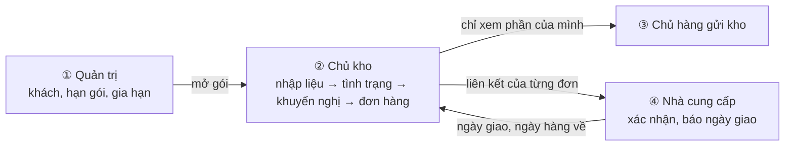
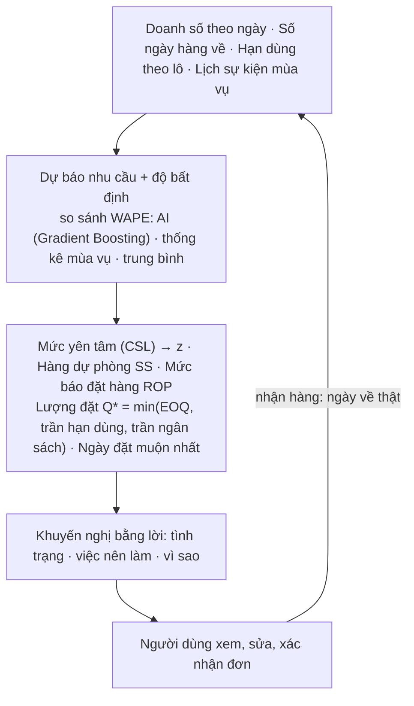
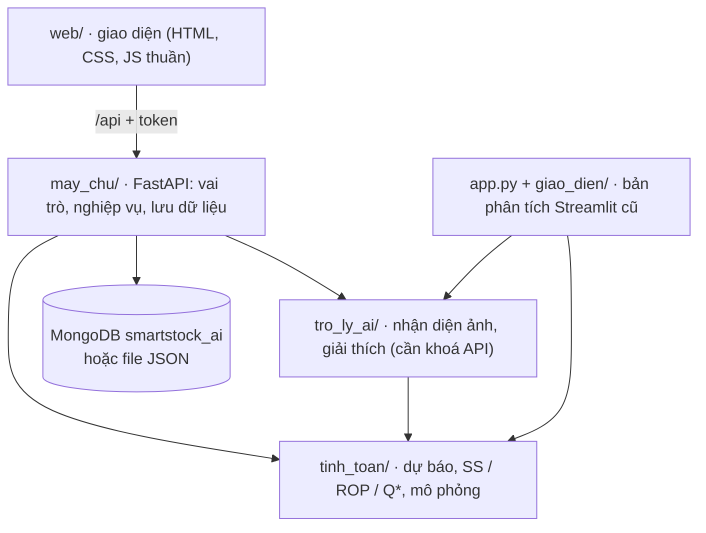

# SmartStock AI

Công cụ gợi ý nhập hàng cho tiểu thương và SME bán hàng có hạn dùng, có mùa vụ. Mỗi ngày cho biết: **còn bao nhiêu hàng,
có cần đặt không, đặt bao nhiêu và muộn nhất ngày nào**. Bắt đầu với bánh kẹo ở chợ truyền thống (Tết, Trung thu).

Đặc tả sản phẩm: **[tai_lieu/DAC_TA_V1.1.md](tai_lieu/DAC_TA_V1.1.md)** · Thuật toán và lịch sử: **[tai_lieu/DU_AN.md](tai_lieu/DU_AN.md)** ·
Hướng dẫn cho người sửa code: **[AGENTS.md](AGENTS.md)**

> Dữ liệu mẫu là **mô phỏng**; giá, hạn dùng và doanh số chỉ để minh hoạ. Mọi con số hiệu quả phải đo lại bằng dữ liệu thật.

## Chạy

```bash
pip install -r requirements.txt
python -m uvicorn may_chu.ung_dung:app --port 8600     # ứng dụng web: http://localhost:8600
python -m pytest tests -q                               # 135 bài kiểm thử
```

Lần chạy đầu app tự nạp dữ liệu mẫu và các tài khoản demo (chọn tài khoản là vào, không có mật khẩu).

| Việc | Cách làm |
|---|---|
| Nơi lưu dữ liệu | MongoDB `mongodb://127.0.0.1:27017/smartstock_ai` (đổi bằng `SMARTSTOCK_MONGO_URI`). MongoDB tắt thì lưu file `du_lieu_cua_toi/smartstock.json` |
| Chạy thử không đụng dữ liệu thật | đặt `SMARTSTOCK_THU_MUC=<thư mục tạm>` trước khi chạy |
| Nạp lại dữ liệu mẫu (xoá dữ liệu SmartStock hiện có) | `python -m may_chu.du_lieu_mau --lam-lai` |
| Bật AI (nhận diện ảnh, giải thích bằng lời) | đặt `OPENAI_API_KEY` (và `OPENAI_MODEL` nếu muốn) trong biến môi trường hoặc `.streamlit/secrets.toml`. Chưa có khoá: app vẫn chạy đủ, chỉ thiếu hai tính năng này |
| Tắt tài khoản demo | `SMARTSTOCK_DEMO=0` (khi đã nối dịch vụ đăng nhập thật vào `may_chu/xac_thuc.py`) |

## Bốn bên và màn hình của từng bên



| Bên | Vào bằng | Màn hình |
|---|---|---|
| ① Quản trị (bên bán dịch vụ) | tài khoản | Khách & gia hạn. Không xem số liệu kinh doanh của khách |
| ② Chủ kho / tiểu thương | tài khoản | ① Nhập liệu → ② Tình trạng kho → ③ Tình trạng hàng → ④ Khuyến nghị đặt hàng → ⑤ Đơn hàng · Chụp ảnh nhận diện |
| ③ Chủ hàng gửi kho | tài khoản | Hàng của tôi (chỉ xem) |
| ④ Nhà cung cấp | liên kết `#/ncc/<mã>` | Xem đơn, xác nhận, báo ngày giao |

Mọi vai trò đều có trang **Hướng dẫn & sơ đồ**: các sơ đồ bấm được (cách dùng từng bước, luồng giữa các bên, app tính thế nào,
sơ đồ mã nguồn).

## Luồng tính



## Cấu trúc mã nguồn



| Thư mục / tệp | Nội dung |
|---|---|
| `web/` | Giao diện web di động trước: `index.html`, `kieu.css`, `js/` (mỗi nhóm màn hình một file) |
| `may_chu/` | `ung_dung.py` (đường dẫn API) · `xac_thuc.py` (tài khoản, vai trò) · `dich_vu.py` (nghiệp vụ) · `kho_du_lieu.py` (lưu, cách ly theo mã kho) · `du_lieu_mau.py` |
| `tinh_toan/` | `du_bao_ai.py` · `khuyen_nghi.py` · `nganh.py` (bản V1.1) · `loi.py` · `nhieu_mat_hang.py` · `so_ghi.py` (lõi gốc) |
| `tro_ly_ai/` | `nhan_dien.py` (ảnh, giải thích) · `tro_ly.py` (khoá API, trợ lý của bản cũ) |
| `tests/` | pytest: lõi tính toán, máy chủ (vai trò, cách ly dữ liệu, đơn hàng), bản Streamlit |
| `app.py`, `giao_dien/`, `pipeline.py` | Bản phân tích cũ (Streamlit) và mô phỏng dòng lệnh: `streamlit run app.py`, `python pipeline.py` |
| `tai_lieu/` | Đặc tả V1.1, hồ sơ thuật toán, tài liệu khoa học |

## Giới hạn hiện tại

- Dữ liệu mẫu là mô phỏng; chưa có dữ liệu thật của quầy hàng nào.
- Đăng nhập là tài khoản demo, chưa nối dịch vụ xác thực thật; chưa có thanh toán.
- Nhận diện ảnh chưa được đo độ chính xác trên ảnh thật; ảnh được gửi tới dịch vụ AI bên ngoài.
- Chưa xử lý: số lượng đặt tối thiểu (MOQ), chiết khấu số lượng, nhiều nhà cung cấp cho một mặt hàng, hàng thay thế.
- Giai đoạn 3 của đặc tả (bản đồ kệ 2D, chuyển hàng giữa chi nhánh, giá giảm động, hỏi đáp BI) chưa làm.
