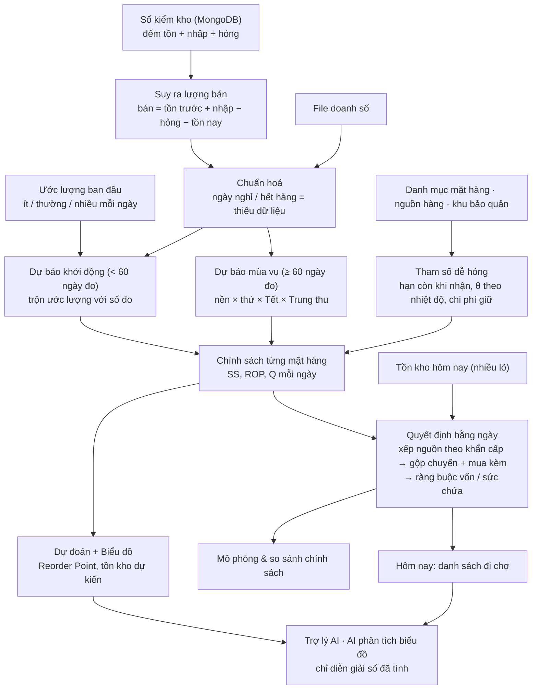

# Hồ sơ dự án – EOQ Bánh Kẹo Chợ

> Nguồn thông tin chính về dự án: mục tiêu, workflow, quy ước, tham số, kết quả và lịch sử chỉnh sửa.
> Cập nhật lần cuối: **21/11/2026** (giai đoạn P14). Quy trình chỉnh sửa và bản đồ code: [`AGENTS.md`](../AGENTS.md).
> Kết quả mới nhất: `output/`. Kết quả chi tiết từng giai đoạn P0–P5, bản Vòng 1 và prompt nộp ban tổ chức đã đóng vào
> `../aie_project_tai_lieu_ngoai_du_an.zip` (ngoài thư mục dự án).

## 1. Tổng quan
Giúp tiểu thương bánh kẹo ở chợ trả lời mỗi ngày: **"đi nhập ở đâu, mua gì, bao nhiêu?"** cho **nhiều mặt hàng thực phẩm**
cùng lúc, có tính hạn dùng, hư hỏng, nhiệt độ bảo quản, vốn và sức chứa kho.

- **Đo lượng bán**: từ file doanh số có sẵn, hoặc từ **sổ kiểm kho** (đếm hàng mỗi tối, app tự suy ra lượng bán) kèm
  **ước lượng ban đầu** của người bán khi chưa đủ ngày đo. Sổ lưu ở MongoDB (dự phòng CSV).
- **Tầng tính toán** (minh bạch, kiểm tra được bằng Excel): dự báo mùa vụ âm lịch → SS / ROP / EOQ → nhập gộp theo nguồn hàng.
- **Tầng AI** (LLM OpenAI): trợ lý tiếng Việt gọi các hàm tính toán (function calling) và giải thích kết quả; **sửa dữ liệu
  theo yêu cầu** (thông số mặt hàng, nguồn hàng, kho, tồn kho, vốn; có kiểm tra hợp lệ và hoàn tác); **ô AI phân tích bên
  cạnh mỗi biểu đồ** (nhận đúng số liệu tóm tắt của biểu đồ đó). Trợ lý **không tự tính số**.

| Thành phần | Vai trò |
|---|---|
| `tinh_toan/loi.py` | Đọc dữ liệu, dự báo mùa vụ + dự báo khởi động, kiểm định theo mùa, SS / ROP / EOQ, mô phỏng một mặt hàng |
| `tinh_toan/nhieu_mat_hang.py` | Hàng dễ hỏng, nhập gộp can-order, ràng buộc vốn / sức chứa, kế hoạch hôm nay, mô phỏng |
| `tinh_toan/so_ghi.py` | Sổ kiểm kho: suy ra lượng bán từ số đếm, ước lượng ban đầu, đọc/ghi sổ (MongoDB hoặc CSV) |
| `tro_ly_ai/tro_ly.py` | Trợ lý AI: LLM + 6 công cụ đọc, 6 công cụ sửa dữ liệu (`BoSua`), phân tích số liệu biểu đồ (`phan_tich`) |
| `pipeline.py` | Chạy toàn bộ luồng bằng dòng lệnh, xuất CSV / JSON / biểu đồ vào `output/` |
| `app.py` + `giao_dien/` | Giao diện Streamlit: menu hai tầng (4 nhóm, 9 trang, mỗi trang một file `giao_dien/trang_*.py`), biểu đồ Altair (`bieu_do.py`) có AI phân tích bên cạnh |
| `tests/` | 135 bài kiểm thử pytest (tính toán, sổ kiểm kho, MongoDB, trợ lý AI giả, test khói mọi trang) |
| `du_lieu_thu/` | Dữ liệu thử: 8 mặt hàng, 01/2024–10/2025, kèm danh mục, nguồn hàng, khu bảo quản |
| `tai_lieu/NGHIEN_CUU_HANG_THUC_PHAM.md` | Tổng quan tài liệu khoa học |

Bản đồ code chi tiết và quy tắc chỉnh sửa: [`AGENTS.md`](../AGENTS.md).

## 2. Workflow

**Một ngày mô phỏng:** đầu ngày hàng về (lô mới có hạn = hạn còn khi nhận) → loại lô hết hạn → hao hụt θ → bán
(FIFO, hoặc một phần khách lựa hàng mới) → cuối ngày quyết định đặt hàng; đơn cùng nguồn, cùng ngày là một chuyến,
lead time ngẫu nhiên nhưng không đảo thứ tự giao hàng.

## 3. Thuật toán và quy ước chính
| Thành phần | Cách tính |
|---|---|
| Dữ liệu thiếu | Ngày không có dòng nào, hoặc cột `het_hang` = 1 → NaN (bỏ qua khi dự báo). Ngày có bán nhưng thiếu dòng một mặt hàng → bán 0 |
| Sổ kiểm kho | Bán (giữa hai lần đếm) = tồn lần trước + nhập thêm − hỏng/bỏ − tồn lần này, chia đều cho các ngày ở giữa; lần đếm có hết hàng → NaN; số âm (quên ghi hàng nhập) → bỏ khoảng đó. Bảng bán hàng dừng ở hôm qua để kế hoạch bắt đầu từ hôm nay |
| Dự báo khởi động (< 60 ngày đo) | Mức/ngày = (7·ước lượng thường + n·trung bình đo) / (7 + n). Phương sai ngày gộp từ (nhiều − ít)/4 và phương sai mẫu, tối thiểu bằng mức/ngày, nhân hệ số thận trọng 1 + 3/(7 + n). Dự báo phẳng, chưa có hệ số thứ / mùa vụ |
| Dự báo | Nhu cầu = mức nền (56 ngày thường gần nhất) × hệ số thứ × hệ số Tết (−60…+30 ngày) × hệ số Trung thu (−45…+10 ngày). Xu hướng có hãm: tuỳ chọn, mặc định tắt |
| Phương sai dự báo | Var = a·d + b·d², ước lượng ngoài mẫu (30 % dữ liệu cuối), tối thiểu bằng d |
| Hạn còn khi nhận | (Hạn in − số ngày đã cũ khi nhận) × Q10^((T_chuẩn − T_khu)/10), hệ số chặn trong [0,3; 1,5] |
| Hư hỏng | θ hiệu dụng = θ ÷ hệ số nhiệt; mỗi ngày mỗi lô mất Binomial(số lượng, θ) |
| Chi phí giữ (EOQ) | H = giá vốn × (lãi vốn + 365θ) + 365 × chi phí biên × thể tích |
| SS, ROP | SS = z·√(Σ phương sai trong lead time + d̄²·Var(L)); ROP = nhu cầu trong lead time + SS. z từ mức phục vụ (mặc định 0,95, nghĩa là CSL) |
| Gộp chuyến (D) | Có mặt hàng ≤ ROP thì đi; mua kèm mặt hàng cùng nguồn ≤ ROP + nhu cầu 0,5·T*; nhập đủ bán k_i·T* ngày, ≤ 60 % hạn còn, làm tròn theo quy cách |
| Chu kỳ gộp | T* = 365·√(2(S + Σ s_i/k_i) / Σ k_i·D_i·H_i); k_i theo heuristic Silver (với tham số mặc định đều = 1) |
| Ràng buộc | Vốn trong ngày và sức chứa dự phóng lúc hàng về; vượt thì tìm nhị phân số ngày đủ bán τ. Nguồn khẩn cấp nhất dùng vốn trước |
| Chi phí | Chuyến (chia đều cho mặt hàng trong chuyến) + dòng hàng + lãi vốn + bảo quản biên + hư hỏng + hết hạn + lợi nhuận mất. Tiền điện cố định báo riêng |
| Mức phục vụ đo được | CSL = tỷ lệ chu kỳ bổ sung không có ngày hết hàng. Không dùng tỷ lệ đáp ứng (luôn khoảng 99,9 %) |
| Tồn khả dụng (EWA) | Phần tồn bán kịp trước hạn. **Tắt khỏi quyết định** (không có lợi, có hại khi khách lựa hàng mới); vẫn dùng để cảnh báo hàng có thể hết hạn |
| Thời gian | Đặt cuối ngày, hàng về đầu ngày t + L (L = 1 thì sáng mai có hàng) |

**Các chính sách so sánh:** A kinh nghiệm (ROP = 7, Q = 14 ngày bán gần nhất) · B EOQ cổ điển (cố định) · C EOQ động
từng mặt hàng · C+G thêm gộp chuyến · C+G+E thêm tồn khả dụng · **D nhập gộp + ràng buộc** (khuyến nghị, đặt-tới-mức).

## 4. Tham số (giá trị minh hoạ, cần đo thực tế)
| Tham số | Mặc định | Nguồn |
|---|---|---|
| Giá vốn / bán, hạn in, quy cách | Theo mặt hàng | Bao bì, hoá đơn (đo được) |
| Hư hỏng θ | 0,005–0,1 %/ngày | Giả định |
| Q10 · nhiệt độ chuẩn | 2,0–2,5 · 25–30 °C | Giả định (tài liệu: Q10 thực phẩm 2–10) |
| Đã cũ khi nhận | 3–60 ngày | Giả định |
| Chi phí chuyến · dòng hàng | 30.000–60.000 đ · 5.000 đ | Giả định |
| Lead time | 1–3 ngày, lệch 0,5–1 | Giả định |
| Kho | Khô 500 l / 30 °C · Tủ mát 150 l / 12 °C (2 đ/l/ngày + 8.000 đ/ngày) · Tủ lạnh 60 l / 4 °C | Giả định |
| Lãi vốn · mức phục vụ · vốn/ngày | 25 %/năm · 0,95 · 10 triệu đ | Giả định |
| Mô hình AI | gpt-4o-mini | Chọn được trong app |

## 5. Kết quả chính
Mọi chính sách **cùng giới hạn vốn 10 triệu/ngày và sức chứa**, cùng nhu cầu và lead time, bỏ 30 ngày khởi động.
Dữ liệu mô phỏng: 6 mặt hàng × 20 lần lặp × 335 ngày.

| Chính sách | Tổng chi phí | Số chuyến | CSL đạt |
|---|---|---|---|
| A. Kinh nghiệm | 17,47 tr | 134 | 97,5 % |
| B. EOQ cổ điển | 13,11 tr | 80 | 94,7 % |
| C. EOQ động từng mặt hàng | 10,34 tr | 90 | 98,1 % |
| **D. Nhập gộp** | **8,02 tr** | **69** | 98,9 % |

| Câu hỏi | Trả lời |
|---|---|
| D có tốt hơn khi so sánh công bằng? | **Có:** rẻ hơn C 22,4 % ± 3,2 (20/20 lần); dữ liệu thử 18,8 % ± 9,5 (19/20). Vững khi học lại dự báo, nhu cầu có sai số dự báo, hàng cũ, khách lựa hàng mới (12–22 %) |
| Tiết kiệm đến từ đâu? | **Gộp chuyến + mua kèm** (−2,3 tr). Bỏ mua kèm thì chi phí tăng khoảng 35 %. Tồn khả dụng ≈ 0 |
| Dự báo Tết đáng tin? | Đỉnh Tết sai 29 % (mô phỏng) / 47 % (dữ liệu thử, 1 mùa), so với 71 % / 66 % của "năm ngoái cùng ngày" |
| Tồn an toàn có thừa? | Thừa nhẹ: CSL 97–99 % so với mục tiêu 95 %. Mức 0,95 vẫn cho chi phí thấp nhất |
| Hàng dễ hỏng ảnh hưởng? | Hàng nhập về đã cũ 50 % hạn làm chi phí tăng 0,4–0,9 tr; lợi thế của D giảm còn khoảng 12 % |
| Giá trị tuyệt đối? | Khoảng 2,3 triệu đ/năm cho 6 mặt hàng, chưa tính tiền điện cố định khoảng 2,7 triệu/năm (như nhau mọi chính sách) |

**Giới hạn:** tham số đa số là giả định; cần ≥ 2 mùa Tết để dự báo đỉnh tốt; chưa có độ ẩm, hàng thay thế, giảm giá hàng sắp
hết hạn, vốn theo dòng tiền; trợ lý AI **chưa chạy thật** vì tài khoản OpenAI hết tín dụng (lỗi 429).

## 6. Lịch sử chỉnh sửa
| Giai đoạn | Nội dung | Kết quả |
|---|---|---|
| Vòng 1 | Bản gốc: Gradient Boosting + chatbot (lưu trong file zip tài liệu ngoài dự án) | — |
| Bỏ ML | Dự báo thống kê mùa vụ, luồng end-to-end `pipeline.py` | Sai số tương đương ML (0,30 so với 0,31) |
| Nhiều mặt hàng | Hạn dùng, hư hỏng, nhiệt độ, nhập gộp, ràng buộc, UI mới, dữ liệu thử | — |
| P0 | Hồ sơ, 16 test, số liệu nền | Cân bằng tồn kho = 0 |
| P1 | Cùng ràng buộc cho mọi chính sách, ablation, phân bổ chi phí chuyến | D −20,4 % so với C; gộp chuyến −2,56 tr |
| P2 | CSL đạt được, nhu cầu nhị thức âm, `--hoc-lai`, bỏ khởi động, độ nhạy | Giữ mức phục vụ 0,95 |
| P3 | Ngày nghỉ = NaN, kiểm định theo mùa, xu hướng (tuỳ chọn) | Đỉnh Tết 29 % so với 71 % |
| P4 | Tuổi khi nhận, θ theo nhiệt, khách lựa hàng mới, không đảo giao hàng, sức chứa thực | Tắt tồn khả dụng; sửa 2 lỗi sức chứa |
| P5 | Hệ số bội k_i, dò can-order (0,5), vốn theo khẩn cấp, tách tiền điện cố định | D −22,4 % so với C |
| P6 | Nhiều lô ở trang Hôm nay, 10 câu hỏi thường gặp, tài liệu | 49 test |
| P7 | Trợ lý AI OpenAI (function calling), nút giải thích, key trong secrets | 55 test; chờ nạp tín dụng |
| P8 | Gọn tài liệu, giao diện nền sáng, đưa kết quả lên đầu trang | — |
| P9 | AI sửa dữ liệu (công cụ ghi có kiểm tra hợp lệ, tính lại kế hoạch, hoàn tác) ở trang Trợ lý và Mặt hàng & kho; AI phân tích dưới biểu đồ Dự báo, Mô phỏng. Sửa lỗi vốn mặc định về 0 khi đổi trang | 65 test; thử trọn luồng bằng AI giả |
| P10 | Tái tổ chức code: `tinh_toan/`, `tro_ly_ai/`, `giao_dien/` (mỗi trang một file), `app.py` chỉ điều phối; thêm `AGENTS.md` (workflow + ràng buộc cho Agent); tài liệu ngoài dự án đóng vào zip. Sửa lỗi trang Mô phỏng in nhầm docstring ra màn hình | 76 test (thêm 11 test khói giao diện) |
| P11 | **Đo lượng bán khi chưa có file doanh số**: sổ kiểm kho (`tinh_toan/so_ghi.py`, bán = tồn trước + nhập − hỏng − tồn nay, đếm cách ngày chia đều, hết hàng = thiếu dữ liệu) và ước lượng ban đầu (ít/thường/nhiều mỗi ngày) trộn với số đo (`loi.du_bao_khoi_dong`); dưới 60 ngày đo dùng dự báo khởi động, đủ 60 ngày chuyển sang mùa vụ. Sổ và thiết lập lưu ở `du_lieu_cua_toi/` (không đưa lên git); phiên mới tự dùng sổ nếu đã có. **Menu mới 8 nút** (Hôm nay, Nhập dữ liệu, Dự đoán, Biểu đồ, Thiết lập, Mô phỏng, Trợ lý AI, Hướng dẫn), trang dùng tên hằng thay cho chỉ số. Trang Dự đoán: điểm đặt hàng, còn mấy ngày thì chạm, giải thích con số. Sửa lỗi màu biểu đồ bị gán theo tên cột xếp chữ cái | 102 test; kết quả số của dữ liệu mô phỏng không đổi |
| P12 | **Giao diện kiểu phần mềm quản lý**: thanh nhóm xanh đậm (Hằng ngày, Phân tích, Thiết lập, Trợ giúp) + menu trang theo nhóm ở thanh bên, nền trắng, chữ và bảng lớn hơn (`baseFontSize` 17), biểu đồ cao 400 px, hệ số mùa vụ chuyển sang tab. Bỏ khu Cài đặt ở thanh bên; **Kế hoạch & vốn thành trang riêng**. **Lưu sổ kiểm kho, ước lượng, thiết lập vào MongoDB** (`eoq_banh_keo`, ghi theo khoá rồi xoá dòng thừa); MongoDB tắt thì dùng CSV | 107 test (có test MongoDB thật, tự bỏ qua nếu không có server) |
| P13 | Trang Biểu đồ thêm **sơ đồ tồn kho có Reorder Point**: tồn kho dự kiến (răng cưa) theo đúng quy tắc đặt hàng, đường ROP, tồn an toàn, điểm đặt ▼ và hàng về ▲, dải số ROP / tồn an toàn / Q. Mọi biểu đồ chuyển sang Altair (`giao_dien/bieu_do.py`): chữ trục và chú thích 15 px, màu đậm. Chốt pre-commit trong máy chặn commit có API key | 107 test |
| P14 | **Dễ đọc và gọn**: bảng màu dịu (nền xám ấm nhạt, chữ xám đậm, bỏ làm mờ chữ ghi chú), chữ `baseFontSize` 18, bảng cao dòng 40 px và vừa khít số dòng (`cao_bang`), nội dung dàn hết chiều ngang. **Ô AI phân tích bên cạnh mọi biểu đồ** (`khung_ai.bieu_do_co_ai`: 6 biểu đồ trang Biểu đồ, 3 biểu đồ trang Mô phỏng), mỗi ô nhận số liệu tóm tắt riêng. Dọn code: xoá 11 hàm/hằng cũ không còn dùng trong `loi.py` (bản một mặt hàng), đổi `trang_thiet_lap.py` → `trang_mat_hang_kho.py`, hằng `MAT_HANG_KHO`, docstring trang theo "Nhóm › Trang", bỏ emoji thay tên trang; viết lại `AGENTS.md` theo thứ tự workflow | 109 test; kết quả số không đổi |
| V1.1 web | **SmartStock AI V1.1** theo `DAC_TA_V1.1.md`: ứng dụng web FastAPI (`may_chu/`) + giao diện di động trước (`web/`), 4 bên (quản trị, chủ kho, chủ hàng gửi kho, nhà cung cấp qua liên kết), lưu MongoDB `smartstock_ai` cách ly theo mã kho. Lõi mới: `du_bao_ai.py` (Gradient Boosting, so sánh WAPE ngoài mẫu với mô hình mùa vụ và trung bình, chọn cách thấp nhất), `khuyen_nghi.py` (SS, ROP, Q* có trần hạn dùng và ngân sách, ngày đặt muộn nhất, what-if CSL, CSL thực tế và fill rate từ mô phỏng, lead time co về mặc định khi ít lần giao), `nganh.py` (gói cấu hình ngành; hoa tươi minh hoạ). Nhận diện mặt hàng bằng ảnh (`tro_ly_ai/nhan_dien.py`, cần khoá API, chưa đo độ chính xác). Trang hướng dẫn dạng sơ đồ bấm được. Bản Streamlit giữ nguyên | 135 test; trên dữ liệu mô phỏng AI ngang mô hình mùa vụ (WAPE chênh dưới 0,02), app tự chọn theo từng mặt hàng |

## 7. Checklist phản biện
Tất cả đã xử lý (✅), trừ các mục ghi nhận là giới hạn (🟨):

| Nhóm | Mã |
|---|---|
| Đánh giá | ✅ A1 cùng ràng buộc · A2 ablation · A3 CSL · A4 sai số dự báo · A5 học lại · A6 khởi động |
| Mô hình tồn kho | ✅ B1 chi phí chuyến · B2 k_i, can-order · B3 thứ tự giao · B4 sức chứa thực · B5 vốn khẩn cấp (🟨 dòng tiền) · B6 tiền điện · 🟨 B7 hàng thay thế |
| Hàng dễ hỏng | ✅ C1 tuổi khi nhận · C2 θ theo nhiệt (🟨 độ ẩm) · C3 độ nhạy Q10 · C4 LIFO |
| Dự báo | ✅ D1 kiểm định Tết · D2 dữ liệu kiểm duyệt · D3 xu hướng (🟨 ít mùa) |
| Phần mềm | ✅ E1 109 test · E2 nhiều lô · E3 sổ kiểm kho + MongoDB · Q1–Q10 câu hỏi thường gặp (trang Hướng dẫn) · AI1 trợ lý LLM · AI2 AI sửa dữ liệu · AI3 AI phân tích biểu đồ (🟨 cả ba chờ nạp tín dụng để chạy thật) |
